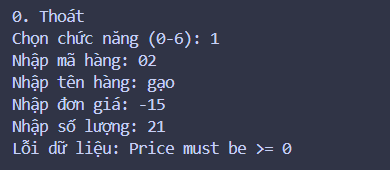
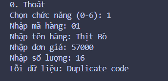
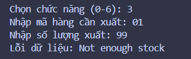
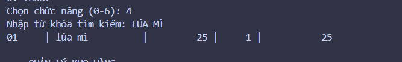
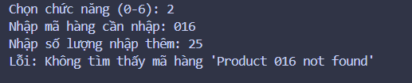
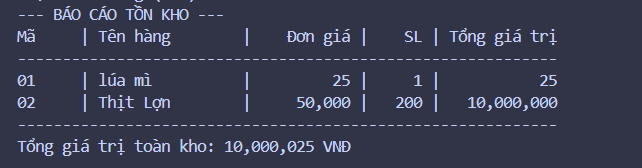

# BÀI 8: QUẢN LÝ KHO HÀNG

## 1. Thành viên và phân công
- Minh Duy: Thiết kế lớp Product và Inventory trong file models.py.
- Minh Duy: Xây dựng giao diện menu console trong file main.py.

## 2. Đối chiếu kiến thức mục 3.1 - 3.6
- 3.1 Thiết kế lớp: Đã thiết kế 2 lớp Product và Inventory.
- 3.2 Thuộc tính: Lớp Product có các thuộc tính code, name, price, quantity.
- 3.3 Phương thức: Các phương thức add, import_stock, export_stock.
- 3.4 Đối tượng: Khởi tạo các đối tượng Product và Inventory trong test_data.py.
- 3.5 Khởi tạo và sử dụng: Sử dụng hàm __init__ để khởi tạo dữ liệu.
- 3.6 Tính đóng gói: Sử dụng @property cho price và quantity để kiểm tra dữ liệu lớn hơn hoặc bằng 0.

## 3. Ảnh chụp thao tác
- Thao tác 1:
- Thao tác 2:
- Thao Tác 3:
- Thao tác 4: 
- Thao tác 5: 
- Thao Tác 6: 

## 4. Khó khăn và cách giải quyết
- Khó khăn 1: Việc bắt lỗi KeyError khi nhập sai mã hàng ở menu. Cách giải quyết: Dùng khối try-except bao quanh các thao tác gọi hàm.
- Khó khăn 2: Định dạng số tiền có dấu phẩy phân cách. Cách giải quyết: Sử dụng format string f"{value:,.0f}".